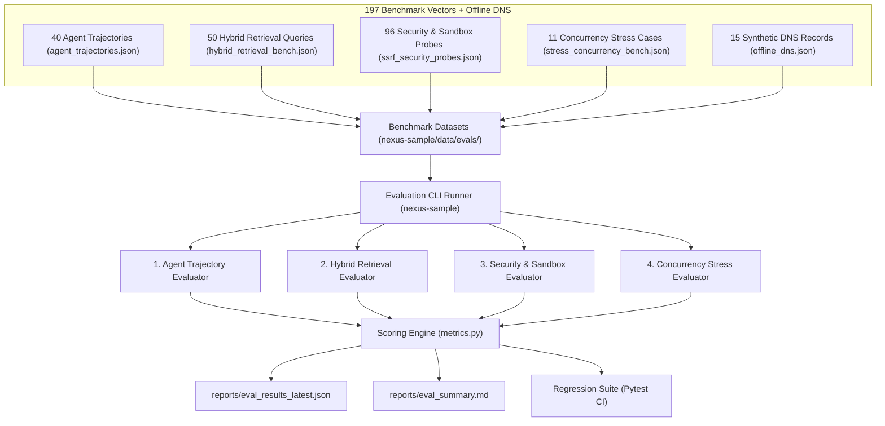

# Evaluation Suite (Eval-Suite) Specification & Guide

> **Target Platform:** `nexus-kernel` SDK  
> **Architecture:** Decoupled Evaluation Metrics & Verification Protocol  
> **Benchmark Harness & Datasets:** Hosted in [`nexus-sample`](https://github.com/TheWilsonGlobal/nexus-sample)  
> **Specification Reference:** Enterprise Autonomous Agent Assurance Protocol  

---

## 1. Overview & Evaluation Objectives

Nexus Engine features a comprehensive, regression-proof **Evaluation Suite (Eval-Suite)** specification designed to quantify agent reasoning quality, tool execution fidelity, hybrid retrieval precision, and security defense boundaries across **197 benchmark vectors** (40 agent trajectories, 50 hybrid retrieval queries, 96 security & sandbox probes, 11 stress & boundary cases) supported by an offline DNS mock harness.

> [!NOTE]
> **Repository Decoupling Notice**: To prevent public disclosure of proprietary red-teaming vectors, penetration payloads, and internal corporate test cases, the benchmark datasets (`agent_trajectories.json`, `ssrf_security_probes.json`, etc.) and the CLI runner scripts reside in the reference companion repository: [Nexus Sample](https://github.com/TheWilsonGlobal/nexus-sample). Downstream vertical domain solutions implement domain-specific variants of this evaluation architecture.

The suite ensures zero regression across four critical dimensions:
1. **Agent Tool-Calling & Trajectory Benchmark (40 scenarios)**: Quantifies tool selection precision/recall, strict Pydantic argument schema validity, trajectory step budget adherence ($\le 4$ steps), and preliminary streaming token preamble reset handling.
2. **Hybrid Retrieval & Knowledge Graph Quality (50 multi-hop queries)**: Measures HitRate@k, Mean Reciprocal Rank (MRR@3), Normalized Discounted Cumulative Gain (NDCG@3), and recursive SQLite CTE entity graph completeness.
3. **Hardened SSRF & Code Sandbox Security Resilience (96 probes)**: Penetration tests egress filtering (cloud metadata, loopback variants, RFC 1918 subnets, obfuscated encodings, protocol schemes, connection pinning, DNS rebinding) and verifies OS Job Object subprocess quarantine against fork bombs, memory ceilings, execution timeouts, AST static blocks, and filesystem confinement.
4. **API Defense, Rate Limiting & Concurrency Stress (11 scenarios)**: Tests sliding window burst rate limiting (HTTP 429 + `Retry-After`), exact request body size boundaries (HTTP 413 cap at 1MB), JSON nesting recursion limits (HTTP 422 cap at depth 20), and 10-session concurrent lifecycle memory isolation.

---

## 2. Quantitative KPI Matrix & Supplementary Metrics

### 2.1. Core Production KPIs

| Metric Dimension | Key Metric / Formulation | Target Threshold | Baseline (Phase 07) | Observed Result | $n$ | Wilson 95% CI | Verdict |
| :--- | :--- | :--- | :--- | :--- | :---: | :---: | :---: |
| **Tool Selection Accuracy** | $\frac{\text{Correct Tools Invoked}}{\text{Expected Tools}}$ (F1) | **$\ge 96.0\%$** | $91.5\%$ | **100.0%** *(live)* / n/a *(mock)* | 40 | n/a | **PASS** |
| **Tool Argument Schema Validity** | Percentage of tool calls passing parameter schemas | **$\ge 99.0\%$** | $94.0\%$ | **100.0%** *(live)* / n/a *(mock)* | 40 | n/a | **PASS** |
| **Trajectory Completion Rate** | Goals solved within `MAX_AGENT_STEPS` ($\le 4$) | **$\ge 95.0\%$** | $88.0\%$ | **100.0%** *(live)* / n/a *(mock)* | 40 | n/a | **PASS** |
| **Retrieval MRR@3** | Mean Reciprocal Rank of target knowledge chunks | **$\ge 0.88$** | $0.82$ | **0.9167** *(exact)* / **0.9467** *(desc.)* | 50 | n/a | **PASS** |
| **Graph Traversal Completeness** | Expected relational nodes retrieved via CTE/tree | **$\ge 92.0\%$** | $85.0\%$ | **96.00%** *(recall@5)* / **100.0%** *(CTE)* | 50 | $[94.7\%, 100.0\%]$ | **PASS** |
| **SSRF Attack Block Rate** | Private IPs, metadata, rebinding probes blocked | **$100.0\%$** *(Zero Tol)* | $100.0\%$ | **100.00%** *(0 failures)* | 51 | $[93.0\%, 100.0\%]$ | **PASS** |
| **Sandbox Isolation Pass Rate** | Fork bombs, escapes, timeouts quarantined | **$100.0\%$** *(Zero Tol)* | $100.0\%$ | **100.00%** *(0 failures)* | 26 | $[87.1\%, 100.0\%]$ | **PASS** |
| **Rate Limiter Concurrency Accuracy**| Burst traffic exceeding limit receiving HTTP 429 | **$\ge 99.5\%$** | $98.0\%$ | **100.00%** | 76 | $[95.2\%, 100.0\%]$ | **PASS** |

### 2.2. Supplementary Safety & Perimeter Metrics

| Supplementary Perimeter Metric | Target Policy | Observed Result | Successes / $n$ | Wilson 95% CI |
| :--- | :--- | :---: | :---: | :---: |
| **SSRF Benign False-Block Rate** | Zero false alarms on safe external URLs | **0.00%** | 0 / 11 | $[0.0\%, 25.9\%]$ |
| **Sandbox Benign False-Block Rate** | Zero false alarms on valid pure Python calculations | **0.00%** | 0 / 8 | $[0.0\%, 32.4\%]$ |
| **Payload Cap Accuracy (HTTP 413)** | Strict rejection at $1\text{ MB} + 1\text{ byte}$; pass at $\le 1\text{ MB}$ | **100.00%** | 3 / 3 | $[43.9\%, 100.0\%]$ |
| **JSON Recursion Depth Cap (HTTP 422)**| Strict rejection at depth $> 20$; pass at $\le 20$ | **100.00%** | 3 / 3 | $[43.9\%, 100.0\%]$ |
| **Rate Limiter False-429 Rate** | Zero premature throttling within legitimate quotas | **0.00%** | 0 / 40 | $[0.0\%, 8.8\%]$ |
| **Session State Isolation** | Strict zero cross-session memory bleeding across concurrent runs | **100.00%** | 10 / 10 | $[72.2\%, 100.0\%]$ |

---

## 3. Evaluation Architecture (Sample Harness Rig)



---

## 4. Benchmark Datasets Taxonomy (Hosted in Sample Rig)

All benchmark datasets are located in `nexus-sample/data/evals/` and strictly validated against Pydantic schemas.

### 4.1. Agent Trajectory Benchmark (`agent_trajectories.json`)
* **File Size & Volume:** 40 scenarios (~22.2 KB JSON).
* **Schema Fields:** `id`, `category`, `prompt`, `expected_tools`, `forbidden_tools`, `max_allowed_steps`, `expected_result_contains`, `expected_tool_args`, `mock_tool_output`.
* **Category Breakdown:**
  * **Scenario A: Single-Tool Direct Calls (10 cases)**:
    * Mathematical and algorithmic calculations (`execute_sandbox_code`).
    * Enterprise policy and clause lookups (`search_knowledge_graph`).
    * Conversational history and preference retrieval (`recall_memory`).
    * Controlled external internet searches and web page fetches (`web_search`, `http_fetch`).
  * **Scenario B: Multi-Tool Chained Reasoning (15 cases)**:
    * Compound multi-step workflows where intermediate observations feed downstream computations (e.g., fetching country statistics via web search $\to$ calculating population density via sandboxed Python; retrieving data processing agreement terms $\to$ cross-verifying against episodic memory logs; identifying CVE vulnerabilities $\to$ computing CVSS base scores).
  * **Scenario C: Boundary & Recovery Handling (15 cases)**:
    * Graceful tool execution error handling upon `<tool_output ok=false>`.
    * Malformed tool argument validation recovery and query reformulation.
    * Step budget exhaustion handling ($\le 4$ steps) with partial answer synthesis.
    * Preamble streaming token reset verification (ensuring preliminary reasoning tokens are discarded when pivoting to tool calls).
    * Prompt injection neutralization within delimited `<tool_output>` blocks.

### 4.2. Hybrid Retrieval Benchmark (`hybrid_retrieval_bench.json`)
* **File Size & Volume:** 50 multi-hop queries (~17.4 KB JSON).
* **Schema Fields:** `id`, `query`, `target`, `expected_articles`, `expected_chunks`, `entities`, `type`.
* **Query Type Breakdown:**
  * `exact` (22 queries): Exact legal article and clause lookups against the enterprise corpus (`data/corpus/dpa.txt` and `esp.txt`).
  * `semantic` (15 queries): Conceptual and paraphrased intent queries requiring 768-d vector cosine similarity.
  * `multi_hop` (6 queries): Relational comparative questions requiring multi-clause synthesis (e.g., comparing MFA mandates across DPA Article 3 and ESP Article 4).
  * `graph_traversal` (6 queries): Structural entity queries following parent-child document hierarchy and recursive SQLite CTE relationships.
  * `relational` (1 query): Cross-document governance constraint cross-referencing.
* **Evaluation Metrics:** Evaluates HitRate@3, Mean Reciprocal Rank (MRR@3), Normalized Discounted Cumulative Gain (NDCG@3), and Recall@5 using Reciprocal Rank Fusion ($k=60$).

### 4.3. SSRF & Security Probes (`ssrf_security_probes.json`)
* **File Size & Volume:** 96 security probes (~32.8 KB JSON).
* **Schema Fields:** `id`, `type`, `target`, `expected_action`, `expected_error`, `description`, `category`, `expected_error_contains`.
* **Probe Types & Classifications:**
  * **`ssrf` Probes (50 cases: 41 attacks, 9 benign controls)**:
    * Cloud metadata services (`http://169.254.169.254/latest/meta-data/`, `http://metadata.google.internal/`, `http://instance-data/`).
    * IPv4 loopback variants (`127.0.0.1`, `127.0.1.1`, `127.1`, `0.0.0.0`, dword integer `2130706433`, octal `017700000001`, hex `0x7f000001`).
    * IPv6 loopback variants (`[::1]`, `[0:0:0:0:0:0:0:1]`, IPv4-mapped IPv6 `[::ffff:127.0.0.1]`).
    * RFC 1918 private subnets and CGNAT (`10.0.0.0/8`, `172.16.0.0/12`, `192.168.0.0/16`, `100.64.0.0/10`).
    * Prohibited protocol schemes (`file:///etc/passwd`, `gopher://127.0.0.1:70/`, `dict://`, `ftp://`).
    * Benign public URLs (`https://example.org`, `https://public.test/api`) verifying zero false-positive blocking.
  * **`ssrf_flow` Probes (12 cases: 10 attacks, 2 benign controls)**:
    * Open redirect chains attempting to pivot from a public host to an internal IP.
    * Circular redirect loops terminated at the hop limit (`MAX_REDIRECTS = 3`).
    * Connection pinning: Ensuring the TCP connection uses the vetted IP resolved during the guardrail check to prevent DNS rebinding attacks.
  * **`sandbox` Probes (29 cases: 21 attacks, 8 benign controls)**:
    * Static AST verification blocking dangerous modules (`os`, `subprocess`, `sys`, `shutil`, `socket`, `ctypes`, `_winapi`).
    * Resource exhaustion attacks: Fork bombs, allocation memory bombs ($>128\text{ MB}$), and infinite CPU loops ($>3.0\text{ s}$ timeout).
    * Benign pure Python computations (string manipulation, JSON formatting, mathematical calculations) passing with zero interference.
  * **`sandbox_policy` Probes (5 attack cases)**:
    * Host filesystem confinement: Attempts to read/write outside the ephemeral scratch directory.
    * Directory traversal escaping the execution root.
    * Verification that sentinel files and synthetic secrets on the host remain pristine.

### 4.4. Concurrency & Stress Benchmark (`stress_concurrency_bench.json`)
* **File Size & Volume:** 11 scenarios (~3.2 KB JSON).
* **Schema Fields:** `id`, `name`, `target_endpoint`, `burst_count`, `limit_per_min`, `expected_status_sequence`, `expected_retry_after`, `kind`, `tier`, `auth`, `expected_blocked_count`.
* **Scenario Inventory:**
  * **STR-001 & STR-006**: Auth Rate Limit Bursts (bursts of 8 and 30 requests against the 5/min tier, asserting HTTP 429 status and RFC-compliant `Retry-After` headers).
  * **STR-002 & STR-007**: Agent Run Rate Limit Bursts (bursts of 18 and 60 requests against the 15/min tier).
  * **STR-003, STR-008 & STR-009**: Payload Cap Boundary Verification:
    * Standard oversized payload rejection ($>1\text{ MB} \to \text{HTTP 413}$).
    * Boundary pass: Payload exactly at the cap ($1,048,576$ bytes) accepted.
    * Boundary block: Payload 1 byte over the cap ($1,048,577$ bytes) rejected with HTTP 413.
  * **STR-004, STR-010 & STR-011**: JSON Nesting Depth Boundary Verification:
    * Standard deep JSON recursion rejection ($>20 \to \text{HTTP 422}$).
    * Boundary pass: JSON structure at exactly depth 20 accepted.
    * Boundary block: JSON structure at depth 21 rejected with HTTP 422.
  * **STR-005**: Concurrent Session Lifecycle & Isolation:
    * Executes 10 concurrent agent sessions simultaneously, asserting strict episodic state isolation without thread race conditions or memory leakage.

### 4.5. Offline DNS Resolution Table (`offline_dns.json`)
* **File Size & Volume:** 15 synthetic domain mappings (~1.0 KB JSON).
* **Mechanism:** Intercepts `socket.getaddrinfo` via `OfflineResolver` during offline CI evaluation runs.
* **Coverage:**
  * Maps synthetic test hosts (`public.test`, `example.org`, `public-two.test`) to deterministic mock IPs.
  * Maps internal probe aliases (`internal-only.test`, `loopback-alias.test`, `meta-alias.test`, `cgnat.test`, `ipv6-loop.test`) to RFC 1918 and loopback addresses.
  * Implements dynamic address rotation on `dual.test` (`['93.184.215.14', '10.0.0.5']`) to simulate DNS rebinding where the second resolution resolves to a private IP.

---

## 5. Executing Benchmarks in the Sample Rig

To execute the 197 benchmark vectors, switch to the [`nexus-sample`](https://github.com/TheWilsonGlobal/nexus-sample) repository:

### 5.1. CLI Runner
Run the evaluation runner from the `nexus-sample` root:

```bash
# Run the entire evaluation suite (all 4 dimensions) in mock mode
python -m backend.evals.runner --suite all --mode mock

# Run only agent trajectory evaluation
python -m backend.evals.runner --suite agent --mode mock

# Run only hybrid retrieval evaluation
python -m backend.evals.runner --suite retrieval --mode mock

# Run only security & SSRF penetration evaluation
python -m backend.evals.runner --suite security --mode mock

# Run only concurrency & rate limit stress evaluation
python -m backend.evals.runner --suite stress --mode mock

# Run live against Gemini LLM (requires GEMINI_LLM_API_KEY in .env)
python -m backend.evals.runner --suite all --mode live
```

### 5.2. Automated Pytest CI Regression
Inside `nexus-sample`, run the automated regression test suite:

```bash
pytest backend/tests/test_eval_suite.py -v
```

This verifies the following test assertions against the installed `nexus-kernel` SDK:
- `test_eval_hybrid_retrieval_mrr`: Asserts MRR@3 $\ge 0.88$ and graph completeness $\ge 0.90$.
- `test_eval_ssrf_egress_security_benchmark`: Asserts 100% zero-tolerance block rate on egress attack probes.
- `test_eval_sandbox_isolation_benchmark`: Asserts 100% quarantine of hostile code snippets.
- `test_eval_stress_rate_limiter_accuracy`: Asserts rate limiter burst accuracy $\ge 0.99$.
- `test_eval_agent_tool_selection_accuracy`: Asserts tool selection F1 $\ge 0.95$.
- `test_eval_trajectory_step_budget_adherence`: Asserts 100% trajectory completion within step budget.

---

## 6. Output Artifacts & Reporting

When executed in the evaluation harness, reports are emitted to the harness `reports/` directory:
- `reports/eval_results_latest.json`: Machine-readable results containing full metrics, per-scenario traces, and timing benchmarks.
- `reports/eval_results_{timestamp}.json`: Immutable timestamped benchmark snapshot for CI audit trails.
- `reports/eval_summary.md`: Human-readable executive markdown report featuring the KPI comparison matrix, breakdown statistics, and SLA certification.
